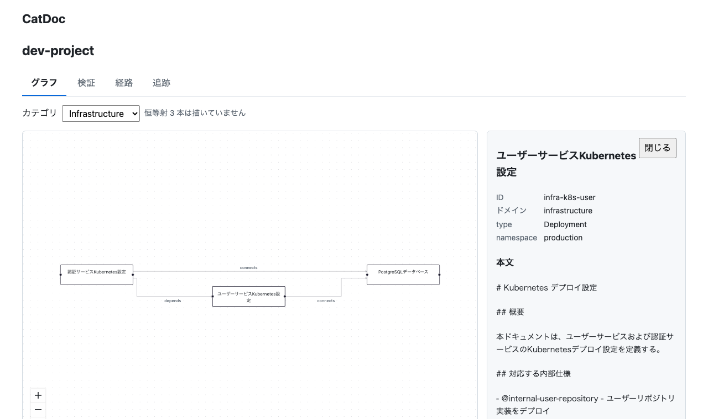
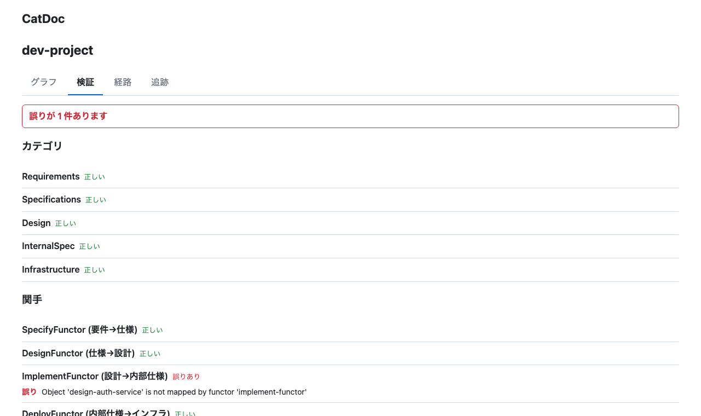
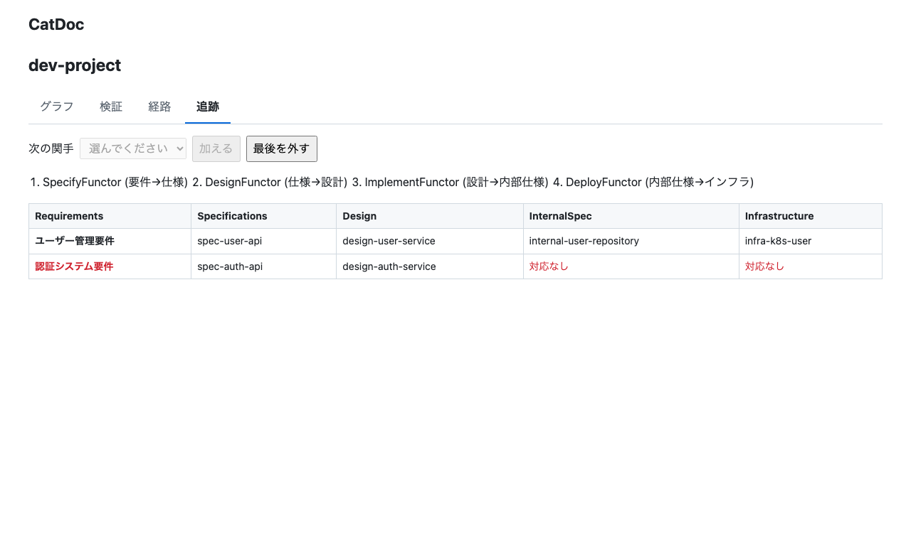
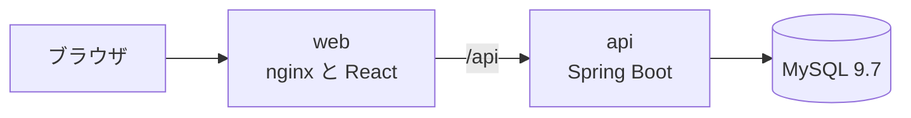

# CatDoc for Spring

文書を圏論の対象、文書どうしの関係を射として扱い、文書群の構造を圏論の公理で検証するツールです。要件から仕様へ、設計から実装へといった層の対応を関手で表し、対応の漏れや食い違いを見つけます。

[category-doc-tool](https://github.com/yokoyamadonuts/category-doc-tool) の TypeScript 版を、Spring Boot と React で書き直し、画面を足しました。



## できること

| 画面 | 内容 |
|---|---|
| グラフ | カテゴリの文書と関係を描く。文書を押すと、メタデータと本文を出す |
| 検証 | 恒等射の有無、射の参照、合成の閉包、関手の対応の漏れ、恒等射と射の向きの保存、自然変換の成分を確かめる |
| 経路 | 同じカテゴリの2つの文書の間の最短経路と、深さ5までの全経路を出す |
| 追跡 | 関手をつなぎ、元の文書が最後の層まで届くかを表にする |

下の2枚は、設計から内部仕様への対応を1つ抜いたときの画面です。検証は抜けた対応を誤りとして示し、追跡の表はその文書の行が途中で切れます。





## 動かし方

Docker があれば、次のコマンドで画面、API、DB が立ち上がります。

```bash
docker compose up -d --build
```

- 画面: http://localhost:18080
- API: http://localhost:18081/api/projects

例のデータを取り込むには、`category.yaml` と Markdown をフォルダごと zip にして送ります。画面からの取り込みはありません。

```bash
cd examples && zip -qr /tmp/dev-project.zip dev-project
curl -i -F file=@/tmp/dev-project.zip http://localhost:18080/api/projects
```

返った `Location` の下で、検証の結果、経路、追跡の表を引けます。

```bash
curl http://localhost:18080/api/projects/{id}/verification
curl "http://localhost:18080/api/projects/{id}/paths?from=infra-k8s-auth&to=infra-database"
curl "http://localhost:18080/api/projects/{id}/traceability?functors=specify-functor,design-functor"
```

API の全体は [openapi/openapi.yaml](openapi/openapi.yaml) にあります。

## 文書の書き方

`category.yaml` にカテゴリ、文書、関係、関手、自然変換を書きます。Markdown は front matter の `id` で文書に結びつき、本文として保存されます。

```yaml
categories:
  - id: requirements
    name: 要件
    objects:
      - { id: req-auth, title: 認証の要件, domain: requirements }
    morphisms:
      - { id: id-req-auth, name: id, source: req-auth, target: req-auth }
  - id: specifications
    name: 仕様
    objects:
      - { id: spec-auth, title: 認証 API の仕様, domain: specifications }
    morphisms:
      - { id: id-spec-auth, name: id, source: spec-auth, target: spec-auth }
functors:
  - id: specify
    name: 要件から仕様へ
    sourceCategory: requirements
    targetCategory: specifications
    objectMapping: { req-auth: spec-auth }
    morphismMapping: { id-req-auth: id-spec-auth }
```

完全な例は [examples/](examples/) にあります。取り込みは構造の誤りだけを 422 で弾き、公理の違反は保存して検証の画面で見せます。理由は [ADR 0007](docs/adr/0007-import-checks-structure-only.md) に書きました。

## 構成



| 場所 | 中身 |
|---|---|
| `domain/` | 圏、関手、自然変換のモデルと、検証、経路探索、追跡の表。依存のない Java の record と純粋な関数 |
| `api/` | Spring Boot。application にユースケース、infrastructure に zip の読み込みと JdbcClient の保存、web にコントローラー |
| `web/` | React。画面ごとに `src/features/` の下に置く |
| `e2e/` | Playwright。docker compose を相手に、API と画面を通す |
| `openapi/openapi.yaml` | API の正本。サーバーは契約テストで比べ、画面は型を生成する |

主な技術は Java 25、Spring Boot 4.1、MySQL 9.7、Flyway、React 19、React Router 8、TanStack Query、@xyflow/react、elkjs、TypeScript 7 です。版の一覧と選んだ理由は [設計書](docs/design.md) にあります。

## テスト

機能ごとに、外側のテストを先に書いて失敗を確かめ、その内側で単体テストを書いてから実装する、二重のテスト駆動で作りました。

| 対象 | 方法 |
|---|---|
| ドメイン | 既存版のテストのケースを JUnit のパラメータ化テストに移し、例のデータの受け入れテストを足した |
| 取り込み、保存、API | 単体テストと、Testcontainers の MySQL 9.7 を相手にした HTTP の結合テスト |
| 仕様との一致 | springdoc の出力と `openapi.yaml` の操作と成功時の状態コードを比べる |
| 画面 | Vitest と Testing Library。グラフの配置は純粋な関数に分けて確かめる |
| 全体 | Playwright で、取り込みから4つの画面までを通す |

| 対象 | 必要なもの | コマンド |
|---|---|---|
| API とドメイン | Java 25、Docker | `./gradlew build` |
| 画面 | Node 26 | `cd web && npm ci && npm run lint && npm run typecheck && npm test` |
| E2E | Node 26、起動した docker compose | `cd e2e && npm ci && npx playwright install chromium && npm test` |

画面の型は `cd web && npm run gen:api` で、README の画像は `cd e2e && npm run screenshots` で作り直せます。

## 既存版との違い

- 保存先を Neo4j から MySQL にし、画面を足した
- 関手の恒等射の保存を、ID の命名 `id-{文書}` ではなく、始点と終点が同じ射として確かめる。既存版の例の dev-project は命名が違い、確かめずに通っていた
- 関手が射の向きを保つかを確かめる。既存版の例のデータには、向きの違う対応が含まれていた
- 自然変換の成分を、元と先のカテゴリから正しく引く
- 全経路を幅優先で探し、深さ5、最大20本で打ち切る

## 設計の記録

- [設計書](docs/design.md)
- [段階ごとの計画](docs/plans/)
- [判断の記録 ADR](docs/adr/)
